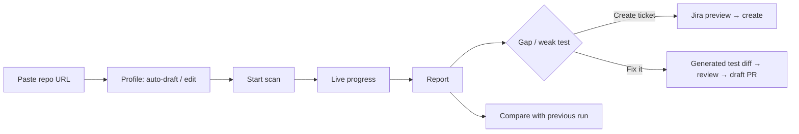

# 01 — Product vision

## Problem

Teams have integration tests but cannot answer three questions:
- *Which API endpoints are really covered?*
- *How good are those tests?*
- *Did we improve since last time?*

A line-coverage percentage is a weak signal for these. A test that drives a request through
the stack but asserts only `200 OK` shows as "covered" while catching almost nothing.

## Idea

A web app where a user pastes a GitHub repo URL and gets an **evidence-backed integration-test
audit**:

- **Coverage map:** the production endpoint list and, for each endpoint, whether an integration
  test exercises it: covered / weak / skipped / none / unverified. Each grade has a clickable
  citation to the exact test.
- **Quality score (0–10):** 7 weighted dimensions (see doc 06), each with a justification of
  four bullets: what is tested, what is missing, the evidence, and why this score.
- **Findings:**
  - false positives (status-only assertions)
  - real dependency boundaries ("seams") no test crosses
  - skipped tests
  - top risks in plain language
- **Actions:** turn any gap into a Jira ticket, or into a PR that adds the missing test.
- **History:** every scan is kept, and any two runs can be compared: newly covered, regressed,
  score moves, risks fixed or new.

## Personas

| Persona | Needs |
|---|---|
| Engineering manager | A one-paragraph verdict, a trend over time, top risks in plain words |
| Tech lead / QA | The endpoint-level map, weak tests, the evidence, and creating tickets |
| Developer | A ready-made PR adding a missing test that follows the repo's existing conventions |

## Feature list (v1)

1. **Repositories:** register a repo by URL, choose a default branch, and attach a **repo profile**
   (Markdown that describes how integration tests are recognized in this repo; see
   `profiles/_template.md`). The profile can be auto-drafted by the LLM, then edited by the user.
2. **Scan:**
   - starts on demand, or on a schedule (optional)
   - pins the commit SHA
   - shows live progress by phase
   - is cancellable
3. **Report view:**
   - summary with KPIs, manager bullets and top risks
   - endpoint coverage table with filters and drill-down
   - quality scorecard
   - findings list
   - citations that link to GitHub at the pinned SHA
4. **Run comparison:** pick any two runs. Adjacent runs show the full item-level delta; other
   pairs show headline numbers only. Comparability warnings are shown prominently.
5. **Jira:** create a ticket from a gap, a risk or a weak test. It is pre-filled, previewed and
   editable. The ticket link is stored on the finding, and the UI shows its status.
6. **Pull request:**
   - the Claude API generates a test that follows existing test conventions (fixtures, base
     classes)
   - the user reviews the diff in the UI, then the app opens a draft PR on a new branch
   - the PR link is stored on the finding
7. **Export:** report JSON download, plus a printable HTML or PDF summary.
8. **Settings:** GitHub, Jira and Claude connections, model choice, and a per-scan token/cost cap.

Out of scope for v1: unit, component and E2E scoring, multi-repo roll-up dashboards,
non-GitHub hosts, executing the target repo's tests.

## Main user flows

