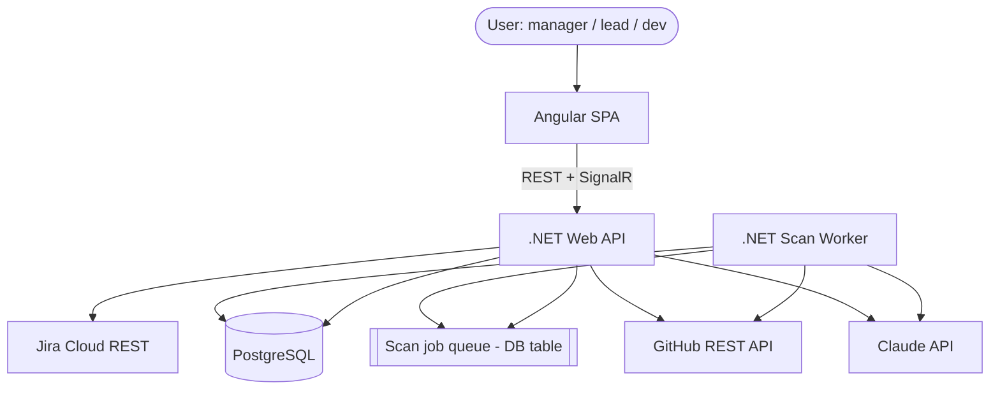
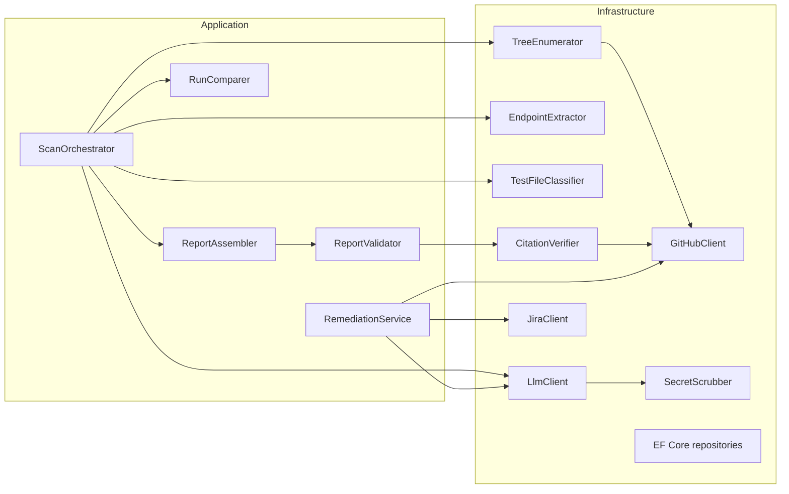
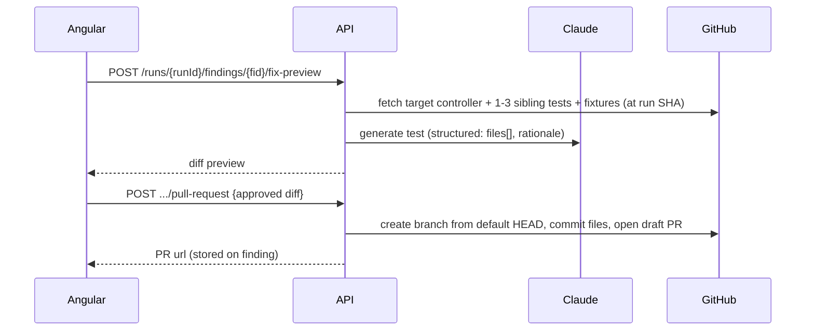

# 02 — Architecture

## System context



## Containers

| Container | Responsibility |
|---|---|
| **web** (Angular, served by nginx) | UI. It holds no secrets and talks only to `api`. |
| **api** (ASP.NET Core) | REST API (`contracts/openapi.yaml`); SignalR hub `/hubs/scans` for progress; auth; Jira/PR actions; enqueues scans |
| **worker** (.NET BackgroundService) | Runs the scan pipeline (doc 05). Dequeues jobs with `SELECT … FOR UPDATE SKIP LOCKED` and publishes progress (through PostgreSQL LISTEN/NOTIFY to the api, or Redis if added later). |
| **db** (PostgreSQL) | Repos, profiles, runs (report JSONB + indexed headline columns), scan steps, findings, actions, connection settings (encrypted) |

A DB-backed queue keeps the v1 infrastructure to three services. `IScanQueue` is an interface,
so a real broker can be swapped in later.

## Components (inside the backend)



## Sequence — scan

```mermaid
sequenceDiagram
  participant U as Angular
  participant A as API
  participant Q as Queue(DB)
  participant W as Worker
  participant G as GitHub
  participant L as Claude
  U->>A: POST /repos/{id}/scans
  A->>Q: insert job (Queued)
  A-->>U: 202 {runId}
  U->>A: SignalR subscribe(runId)
  W->>Q: dequeue
  W->>G: resolve branch → commit SHA; GET tree?recursive=1
  W->>W: enumerate prod endpoints + candidate test files (deterministic)
  W->>G: fetch file contents (batched, cached by blob SHA)
  W->>L: classify tests / map tests→endpoints / grade (structured JSON)
  W->>W: assemble summary, validate, compare with previous run
  W->>G: verify every citation at pinned SHA
  W->>A: progress events per phase
  W->>Q: mark Succeeded (or Failed with reason)
  A-->>U: run completed → load report
```

## Sequence — fix PR



## Cross-cutting

- **Idempotency:** GitHub file fetches are cached by blob SHA in the DB. LLM results are cached
  by a hash of (prompt version, model, input). Re-running a scan at the same SHA is cheap.
- **Budgets:** each scan has a max-token / max-cost cap. When the cap is hit, the remaining
  items become `unverified`. They are never guessed.
- **Rate limits:** the GitHub client honours `X-RateLimit-*` and retries with backoff (Polly).
  The LLM client honours 429/529 with backoff.
