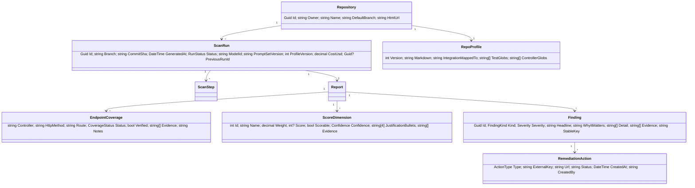

# 03 — Backend (.NET 9)

## Solution layout

```
src/
  Coverage.Domain/            entities, value objects, enums, domain rules (no deps)
  Coverage.Application/       use cases, interfaces (ports), ReportAssembler, ReportValidator, RunComparer, Scoring
  Coverage.Infrastructure/    EF Core, GitHub/Jira/Claude clients, extractors, SecretScrubber, prompt loader
  Coverage.Api/               controllers, SignalR hub, auth, DI, OpenAPI
  Coverage.Worker/            BackgroundService host for scans
tests/
  Coverage.Domain.Tests/          unit
  Coverage.Application.Tests/     unit (assembler/validator/comparer — golden files from examples/)
  Coverage.Api.IntegrationTests/  WebApplicationFactory + Testcontainers PostgreSQL + WireMock (GitHub/Jira/Claude)
prompts/  (copied from blueprint, embedded resources)
```

## Domain model



Enums:
- `CoverageStatus` = Covered | Weak | Skipped | None | Unverified
- `RunStatus` = Queued | Running | Succeeded | Failed | Cancelled
- `FindingKind` = UncoveredEndpoint | WeakTest | FalsePositive | SkippedTest | UncoveredSeam | Risk
- `ActionType` = JiraTicket | PullRequest

`Finding.StableKey` is a deterministic key, for example
`uncovered-endpoint:POST /orders/{id}/cancel`. It is used to match findings across runs and to
avoid duplicate tickets.

## Persistence

- `scan_runs.report_json jsonb` stores the full immutable report (the canonical artifact). It is
  validated against `contracts/integration-report.schema.json` before insert.
- Denormalized columns for listing and trends: `score`, `weight_assessable_pct`,
  `endpoints_total`, `endpoints_covered`, `endpoints_weak`, `endpoints_none`, `endpoints_unverified`.
- `findings` and `remediation_actions` are relational. Actions outlive runs: a ticket created
  from run N is still shown on the same `StableKey` in run N+1.
- `file_cache(blob_sha pk, content)` and `llm_cache(key pk, response_json)`.
- Mark runs immutable: no UPDATE of `report_json` after `Succeeded`. Enforce this with a DB
  trigger.

## Key services (Application)

| Service | Contract |
|---|---|
| `IScanOrchestrator.RunAsync(runId, ct)` | Executes pipeline phases P1–P7 (doc 05) and records a `ScanStep` per phase |
| `IEndpointExtractor` | Language strategy pattern. v1: ASP.NET Core (`[Route]`, `[HttpGet]`…, minimal APIs `MapGet`…). It is pluggable (Spring, Express, FastAPI) and uses Roslyn syntax trees for C#, falling back to the LLM for unknown frameworks (marked `[inferred]`) |
| `ITestFileClassifier` | Applies profile globs/attributes deterministically first, then asks the LLM only for ambiguous files |
| `ReportAssembler` | Pure function: detail → summary, scores, manager bullets. No I/O |
| `ReportValidator` | Re-derives everything the assembler computed and checks the schema, evidence format and trust rules. Returns a list of violations |
| `ICitationVerifier` | For each `path::Test`, confirms the file exists at the SHA and that the test name appears as a test declaration |
| `RunComparer` | Pure function: (older, newer) → `Delta` (doc 08) |
| `RemediationService` | Jira and PR previews, and the actions (doc 09) |

## API surface

See `contracts/openapi.yaml`. Summary:

- `POST /api/repositories`
- `GET /api/repositories`
- `GET /api/repositories/{id}`
- `GET|PUT /api/repositories/{id}/profile`
- `POST /api/repositories/{id}/profile/draft`
- `POST /api/repositories/{id}/scans`
- `GET /api/repositories/{id}/runs`
- `GET /api/runs/{runId}` (the report)
- `GET /api/runs/{runId}/export`
- `DELETE /api/runs/{runId}/cancel`
- `GET /api/runs/compare?base={a}&target={b}`
- `POST /api/runs/{runId}/findings/{findingId}/jira-preview` and `/jira`
- `POST /api/runs/{runId}/findings/{findingId}/fix-preview` and `/pull-request`
- `GET|PUT /api/settings/connections`
- `POST /api/settings/connections/{kind}/test`
- SignalR `/hubs/scans`: `ScanProgress(runId, phase, pct, message)`, `ScanCompleted(runId, status)`

## NuGet (suggested)

- Microsoft.EntityFrameworkCore + Npgsql
- Octokit (or a typed HttpClient)
- Anthropic SDK for .NET (or a typed HttpClient to the Messages API)
- Polly
- FluentValidation
- Serilog
- OpenTelemetry
- Microsoft.CodeAnalysis.CSharp (Roslyn)
- NJsonSchema
- Testcontainers.PostgreSql
- WireMock.Net
